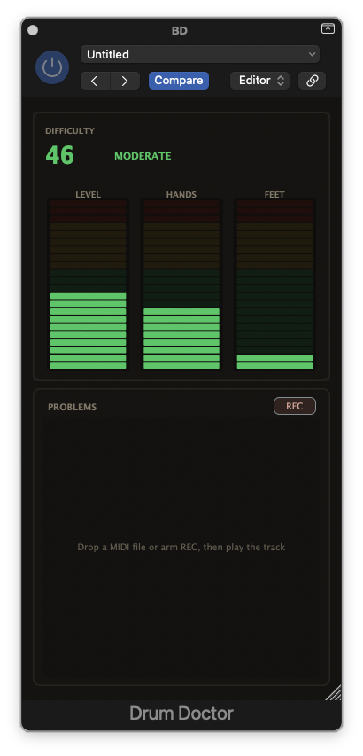
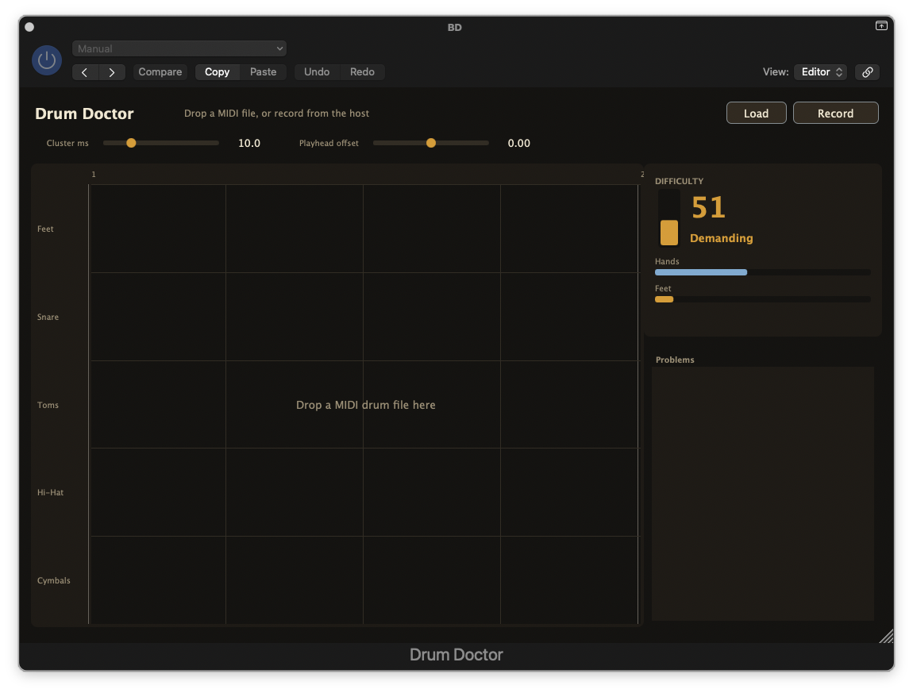

# Drum Doctor

Drum Doctor reads a General MIDI drum part and decides whether a drummer can play it. A hit needs a limb. There are two hands and two feet, and a closed hi-hat keeps one foot down until the hat opens.

It is a MIDI effect. Notes pass through unchanged, and it does not make sound. It builds as an Audio Unit, a VST3, and a standalone app.

Two views share one analysis:

- **Analyse track** listens to one pass, or a dropped `.mid` file, and lists every chord a drummer cannot play, with bar and beat.
- **Difficulty** follows playback. The meter rises with speed and with how many limbs are busy at once. An impossible hit pins it.

## What counts as unplayable

Notes that land within 10 ms of each other are one chord. That window is measured from the first note, so a loose flam stays separate and only affects difficulty. The standalone app can change the window from 1 to 40 ms.

Inside a chord:

- At most two hands. Three cymbals, or a snare plus two toms, is impossible.
- At most two feet. Two kicks under a still-closed hi-hat are impossible, because the hat already occupies a foot.
- A closed hi-hat (note 42) is a hand and also puts the hat foot down until an open hi-hat (note 46).
- A pedal chick (note 44) is that same foot for the chord it lands on. It does not leave the hat closed.

Anything outside the kit map is ignored and counted, including pitched notes.

| Notes | Voice | Limb |
| --- | --- | --- |
| 35, 36 | Kick | Foot |
| 37 | Side stick | Hand |
| 38, 40 | Snare | Hand |
| 41, 43, 45, 47, 48, 50 | Toms | Hand |
| 42 | Closed hi-hat | Hand, and holds a foot |
| 44 | Hi-hat pedal | Foot, for that chord only |
| 46 | Open hi-hat | Hand, and releases the hat foot |
| 49, 57 | Crash | Hand |
| 51, 59 | Ride | Hand |
| 52 | China | Hand |
| 53 | Ride bell | Hand |
| 55 | Splash | Hand |
| 56 | Cowbell | Hand |

## Difficulty

The meter looks at the last quarter note and updates on every 64th. Speed is how fast the busier limb is moving. Sixteen hits a second fills the speed scale, which is 16th notes at 120 bpm sitting halfway up. Coordination rises when hands and feet are busy together. The bands are Comfortable, Moderate, Demanding, and Extreme. Impossible overrides the band.

In the plugin the columns are LEVEL, HANDS, and FEET. They rise quickly and fall a little more slowly, with a peak dot on each column.

## Logic Pro



Put Drum Doctor in the MIDI FX slot of a software instrument track.

1. Quit Logic completely, then open the project and the Drum Doctor window. Logic keeps an Audio Unit loaded until the app quits. If the old window is still there, use Logic Pro > Settings > Plug-in Manager, select Drum Doctor, choose Reset & Rescan Selection, then quit and reopen.
2. Press **Analyse track**. Leave cycle off.
3. Play the part from the start, then press stop. The list under **Can't be played** fills in when playback stops. The button can stop the pass early.
4. Play the part again to watch the difficulty meter. That second pass is only for display. The list stays as analysed.

Starting the analysis while Logic is already playing listens from the current position. Cancel before play leaves the previous result untouched. Dropping a `.mid` file on the window analyses that file instead of the track. A dropped file treats its first bar as bar 1.

## Standalone



The standalone app is the editing view: a lane timeline, the problem list, and the meter. Load a MIDI file, or press Record and play into it, then press Play. Play only moves the cursor and the meter. Open a file from the command line by passing its path.

Cluster ms groups notes into chords. Playhead offset, in quarter notes, shifts a dropped file against the timeline when bar 1 of the file is not bar 1 of the project. A region that starts at bar 5 in 4/4 needs an offset of 16. A pass recorded from a host already uses the host's bar positions, so the offset stays at 0.

## Build

CMake fetches JUCE 8.0.8. On macOS, CMake and Ninja from Homebrew are enough. Xcode supplies the compiler.

```bash
export PATH="/opt/homebrew/bin:$PATH"
cmake -S . -B build -G Ninja -DCMAKE_BUILD_TYPE=Release
cmake --build build --target DrumDoctor_All -j 8
```

Outputs:

| Format | Path |
| --- | --- |
| Audio Unit | `build/DrumDoctor_artefacts/Release/AU/Drum Doctor.component` |
| VST3 | `build/DrumDoctor_artefacts/Release/VST3/Drum Doctor.vst3` |
| Standalone | `build/DrumDoctor_artefacts/Release/Standalone/Drum Doctor.app` |

The build does not copy plug-ins into the system folders. For Logic:

```bash
DEST="$HOME/Library/Audio/Plug-Ins/Components"
rm -rf "$DEST/Drum Doctor.component"
cp -R "build/DrumDoctor_artefacts/Release/AU/Drum Doctor.component" "$DEST/"
```

Then quit Logic and reopen the project.

## Tests

```bash
cmake --build build --target DrumDoctorTests -j 8
./build/DrumDoctorTests
```

The tests cover limb limits, a closed hat holding a foot, a chick that does not latch the hat, flams versus chords, the difficulty of a steady 16th-note pattern, and a MIDI file round trip.
